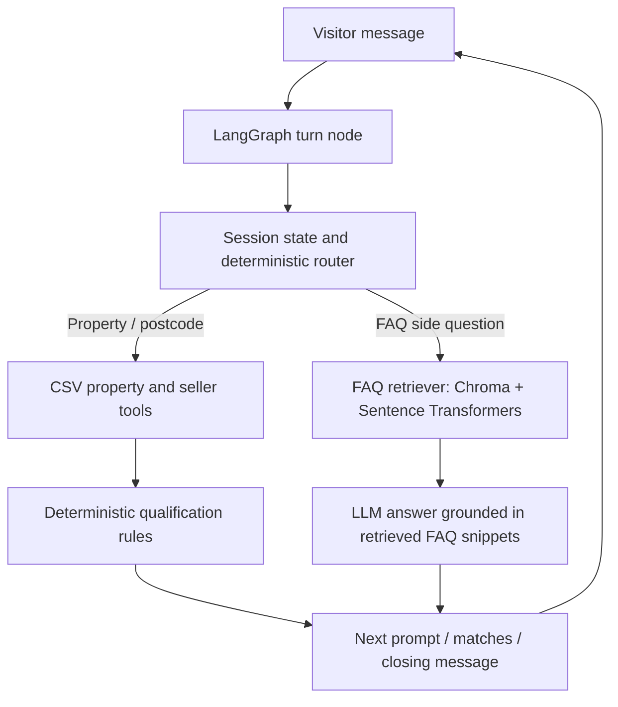

# Ashcombe & Rowe Estates — AI Lead Qualification Chatbot

A Python, LangGraph-orchestrated chatbot that qualifies property buyers and sellers against the supplied agency data. It keeps qualification rules deterministic and uses an LLM only for language-grounded FAQ responses; the FAQ retrieval layer uses a Chroma vector store with local Sentence Transformers embeddings. If no LLM key or optional vector dependencies are available, the app falls back to deterministic responses and lexical FAQ retrieval.

## Features

- Buyer lane A: new-build budget gate (£1m minimum), postcode inventory check, available-only filter, and budget filtering.
- Buyer lane B: resale budget captured but not used as a filter; postcode and available inventory checks.
- Buyer lane C: specific-property lookup by property name, address, or ID; ambiguous results ask for clarification; retries once if not found; sold/under-offer properties route to a similar-home journey.
- Seller lane D: postcode checked against `seller_coverage.csv`, independently of property inventory.
- Contact details are requested only after qualification; phone then email are validated before the 24-hour call-back message.
- FAQ side questions are answered from `faq.csv` without advancing the current step. Property questions use the property data.
- Budget formats such as `£1.5m`, `1,200,000`, `1.2 million`, and `950k`; postcode matching ignores case and spaces.
- Session state/memory and conversation history; explicit buy/sell changes restart the relevant journey.
- CLI interface, automated tests, environment configuration, and the supplied flowchart/data.

## Architecture



### Design choices and trade-offs

- **LangGraph:** each user turn is processed through a graph node with the session passed as state. Session state is stored in memory by session ID. For multi-user deployment, replace this dictionary with Redis or a database-backed checkpointer.
- **Deterministic qualification:** budgets, postcode checks, availability and contact gating are regular Python logic rather than LLM decisions. This avoids an LLM accidentally qualifying an ineligible lead.
- **FAQ RAG:** FAQ question/answer pairs are embedded locally and stored in Chroma. Retrieved FAQ snippets are the only source passed to the LLM for answer generation. If vector dependencies are unavailable, a lexical retrieval fallback is used; this fallback is less semantically accurate.
- **Structured data:** exact postcode/category/status/budget filters are performed with pandas, not semantic search, because these are exact business rules. Property name/address/ID lookup uses case-insensitive substring matching.
- **Provider adapter:** `LLM_PROVIDER` supports `openai`, `gemini`, `groq`, `openrouter`, `mistral`, and `ollama` through their LangChain integrations. The assignment reviewer supplies credentials; no keys are committed.
- **Assumptions:** postcode equality is normalized by removing spaces and uppercasing. A property is offerable only when `status == available`. Lane C is implemented. A qualified buyer is offered up to five available matches; a direct, available property lookup proceeds to contact qualification as specified.
- **LLM/model tested:** this deliverable was not run against a live provider in this environment. Default configuration is Groq `llama-3.3-70b-versatile`, but the reviewer should record the actual provider/model after testing with their own key. FAQ retrieval uses `sentence-transformers/all-MiniLM-L6-v2`.

## Setup

Python 3.10+ recommended.

```bash
python -m venv .venv
# Windows:
.venv\Scripts\activate
# macOS/Linux:
source .venv/bin/activate

pip install -r requirements.txt
copy .env.example .env  # Windows; on macOS/Linux use: cp .env.example .env
```

Edit `.env` and set `LLM_PROVIDER`, `LLM_MODEL`, and `LLM_API_KEY`. `LLM_BASE_URL` is optional. `EMBEDDING_MODEL` defaults to a local Sentence Transformers model; the first run may download model files. The app can start without an LLM key, but FAQ answers use the lexical fallback and no LLM generation.

Run from the project root:

```bash
python main.py
```

Enter `/quit` to exit. The CLI creates one in-memory session. For a web app, call `LeadChatbot.reply(session_id, message)` from a FastAPI endpoint and use a unique opaque session ID per visitor.

## Tests

```bash
pytest -q
```

The tests cover budget parsing, email/phone/postcode validation, normalized seller coverage, the new-build minimum budget, buyer qualification, FAQ interruptions/resumption, and seller rejection without collecting contact details.

## Sample transcripts

### Lane A — New-build buyer (qualification rejection)

```text
Assistant: Hello! How may I help you? May I have your name?
You: Priya
Assistant: Thanks, Priya. Are you looking to buy or sell a property?
You: Buy
Assistant: Do you have a specific property in mind? (yes/no)
You: no
Assistant: Are you looking for a new-build or a resale home?
You: new-build
Assistant: What is your budget?
You: 950k
Assistant: Sorry, we don't cater to new-build properties under £1 million. Our office number is 020 7946 0100. Goodbye.
```

### Lane B — Resale buyer with FAQ interruption

```text
Assistant: Hello! How may I help you? May I have your name?
You: Daniel
Assistant: Thanks, Daniel. Are you looking to buy or sell a property?
You: buy
Assistant: Do you have a specific property in mind? (yes/no)
You: no
Assistant: Are you looking for a new-build or a resale home?
You: resale
Assistant: What is your budget?
You: 400k
Assistant: What postcode are you interested in?
You: What are your opening hours?
Assistant: [Answer retrieved from faq.csv; repeats the postcode prompt.]
You: [postcode containing an available resale listing]
Assistant: [Up to five available resale matches; asks for phone number.]
You: +44 7700 900123
Assistant: Thank you. What is your email address?
You: daniel@example.com
Assistant: Someone will get in touch within 24 hours via phone or email. Is there anything else I can help you with?
You: no
Assistant: Thank you for chatting with us. Goodbye.
```

### Lane D — Seller not covered

```text
Assistant: Hello! How may I help you? May I have your name?
You: Alex
Assistant: Thanks, Alex. Are you looking to buy or sell a property?
You: sell
Assistant: What is the property's postcode?
You: SW1A 1AA
Assistant: Sorry, we don't cater to the postcode you provided. Our office number is 020 7946 0100. Goodbye.
```

### Lane C — Specific available property

```text
Assistant: Hello! How may I help you? May I have your name?
You: Morgan
Assistant: Thanks, Morgan. Are you looking to buy or sell a property?
You: buy
Assistant: Do you have a specific property in mind? (yes/no)
You: yes
Assistant: Which property name or address are you interested in?
You: Apartment 1, Aldermoor Place
Assistant: That property is available: Apartment, 2 bedrooms, £1,330,000. What is your phone number so we can arrange a call-back?
```

## Production hardening

### Risks handled
- **Prompt injection / rule override:** qualification is deterministic and never delegated to the LLM. FAQ generation is constrained to retrieved snippets.
- **Hallucinated business details:** if no relevant FAQ match is found, the bot gives the published office number rather than fabricating a response.
- **Unqualified lead data collection:** phone/email steps are reachable only after a positive qualification result.
- **Unavailable inventory:** sold and under-offer listings are excluded from match results.
- **Malformed input:** budget, phone, email and postcode validation prompts for correction.
- **Provider failure:** the app continues with deterministic routing and lexical FAQ fallback if LLM/vector-store setup fails.

### Further work for production
- Persist sessions securely in Redis/Postgres; encrypt contact details, set retention/deletion policies, and redact PII from logs/traces.
- Add authentication/authorization for staff lead retrieval, consent notice, GDPR data-subject workflows, and audit logs.
- Add robust UK postcode validation (e.g. a maintained library), E.164 phone parsing, rate limits, abuse controls, and per-IP/session quotas.
- Use a relevance threshold and a retrieval evaluation set for FAQ RAG; the current lexical fallback is approximate and the vector path should be evaluated against human-labelled queries.
- Add provider retry/backoff, timeout/circuit-breaker handling, token/cost tracking, LangSmith/Langfuse tracing, and graceful user-facing error messages.
- Deploy FastAPI with session storage, health checks, structured logs, metrics, secrets manager, CI, dependency pinning/scanning, and Docker.
- Add more end-to-end tests for ambiguous Lane C matches, sold/under-offer branches, mid-flow journey changes, all M1/M2/M3 paths, provider rate limits, and prompt-injection attempts.

## Optional FastAPI / Docker

Start the HTTP API locally:

```bash
uvicorn api:app --reload
```

- `GET /health`
- `POST /chat` with JSON `{"session_id":"visitor-123","message":"I want to buy"}`

Build and run the container:

```bash
docker build -t ashcombe-chatbot .
docker run --rm -p 8000:8000 --env-file .env ashcombe-chatbot
```

The included API keeps sessions in process memory for demonstration. Do not use this session storage behind multiple workers or in production; use a shared persistent store.
